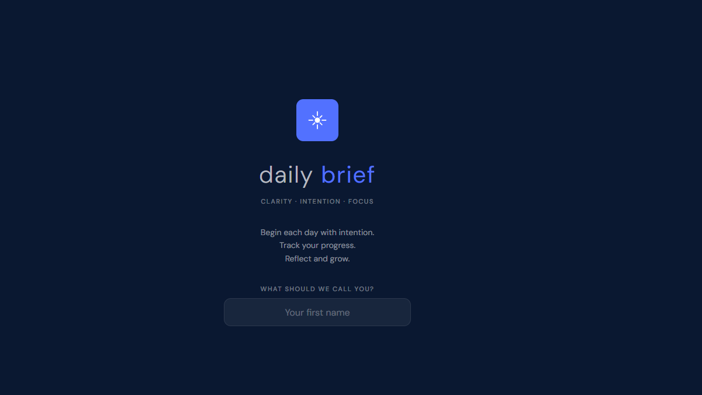

# Daily Brief

Clarity · Intention · Focus. A daily app for setting morning intentions, checking in at midday and reflecting in the evening. Designed in Figma Make, built in React, and packaged for web, Android and iOS.

**Live:** https://daily-brief-olive.vercel.app

## Features

- Morning intentions, a midday check-in and an evening reflection, each on its own screen
- Dashboard, plus a progress ring that shows how many of today's intentions are done
- History of past days
- Daily reminders through native notifications on mobile
- Entries saved on the device, with a native backup so the phone doesn't clear them
- Haptic feedback on mobile
- Automatic Android build on GitHub Actions

## Built with

React · TypeScript · Vite · Tailwind CSS · React Router · Capacitor (Android and iOS) · Vercel

## Getting started

Requires Node 22 or newer (run `node -v` to check).

    git clone https://github.com/robertandersonux/daily-brief.git
    cd daily-brief
    npm install
    npm run dev

Then open http://localhost:5173 (or the port shown in your terminal).

## Mobile builds

    npm run cap:android   # builds the web app, syncs it and opens Android Studio
    npm run cap:sync      # builds and syncs both Android and iOS

Deployed on Vercel. Every push to `main` redeploys.
